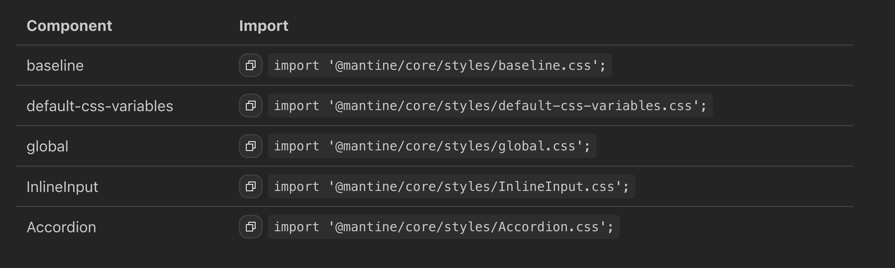

<h1>Оптимизация CSS</h1>

И дальше подключаем точечно стили компонента

  

<DeckLink class="imports-source" href="https://mantine.dev/styles/css-files-list/">https://mantine.dev/styles/css-files-list/</DeckLink>

