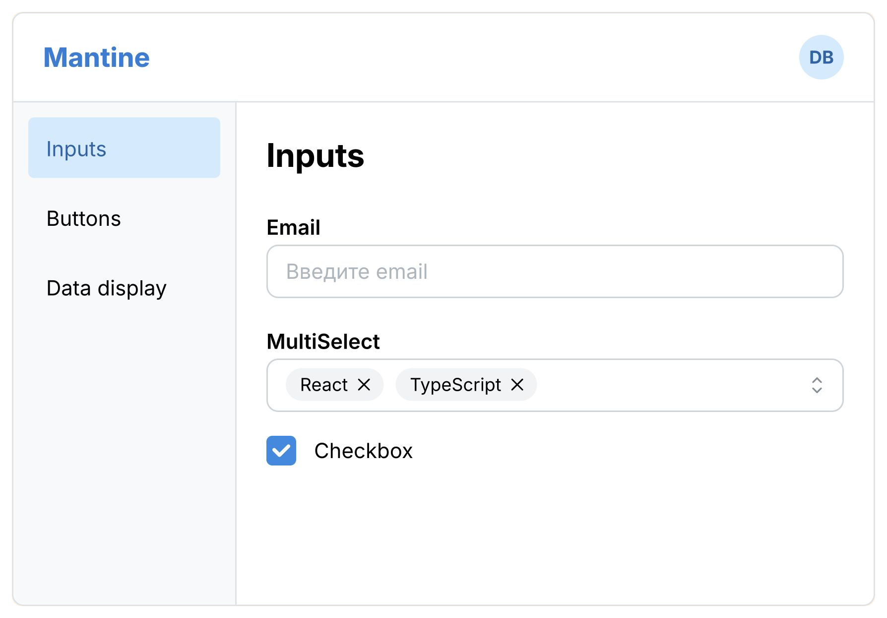
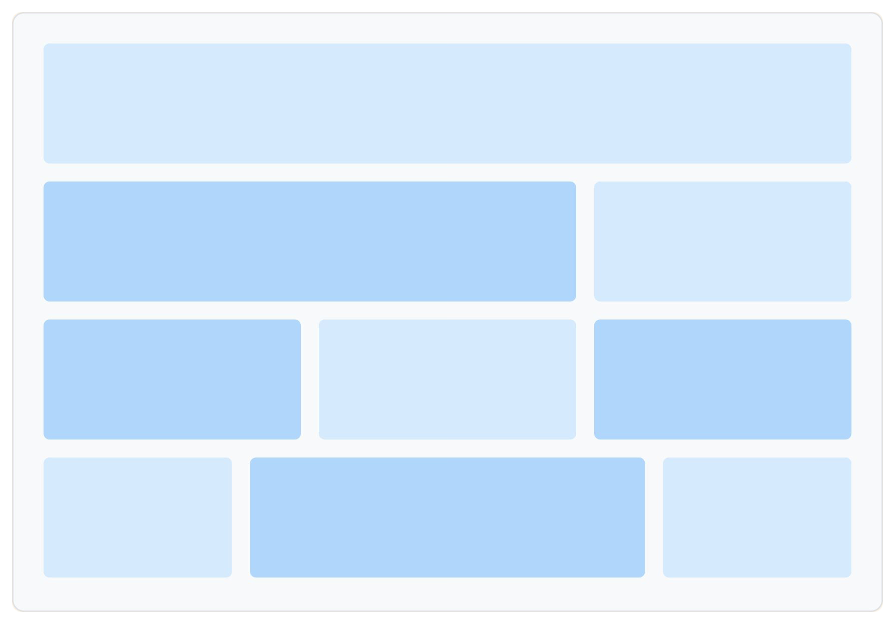

# @mantine/core

  <section>
    <h2><a href="https://mantine.dev/core/app-shell/">Layout: AppShell</a></h2>
    
  </section>
  <section>
    <h2><a href="https://mantine.dev/core/grid/">Layout: Grid</a></h2>
    
  </section>

